# 睡眠打卡（Sleep Check-in）

一款只装在自己手机上的安卓睡眠记录 App：睡前 / 起床一键打卡，顺手记一句梦，用报表、徽章和睡眠质量测评帮自己坚持规律作息。

完全离线：无账号、无广告、无网络请求，数据只保存在本机 SQLite。

## 功能

**打卡与记录**

- 18:00 后首页显示「我要睡了」，凌晨 / 早晨显示「我醒了」；跨零点打卡按醒来那天归属，时长自动计算。
- 起床浮层里入睡时间和起床时间都可以直接修改，带 1~5 星质量评分、梦境小记和备注（均可跳过）。
- 统计页支持补录、编辑、删除，补录记录带「手动补录」标记。
- 睡前 / 起床打卡提醒：两个每日本地通知，时间与开关可调，手机重启后自动恢复排期。

**统计与分析**

- 月历色块：绿=达标、黄=时长不足、空心=只打了睡前卡、灰=未打卡。
- 周 / 月趋势图：睡眠时长柱状图 + 入睡时间折线图。
- 近 30 天指标：平均入睡 / 起床 / 时长 / 质量、打卡完成率。
- 规律性评分：近 14 天入睡与起床时间波动折算 0~100 分。
- 周报：最近 8 周的平均值、环比变化、规律性和最好的一晚。
- 睡眠质量测评：近 14 天综合评分、评分构成、问题分析和改善建议（详见下文）。
- 睡眠余额：近 7 天睡眠负债与社交时差（工作日/休息日睡眠中点差），测评分析同步给出判断。

**激励与目标**

- 12 枚徽章：连续打卡 3/7/21/66/100 天、早睡之星、自律之月、钟表体质、亡羊补牢、满月全勤、千里之行、浪子回头。
- 解锁瞬间全屏庆祝动效 + 本地通知，徽章墙展示点亮状态与进度。
- 每周早睡目标：目标时间与每周达标天数可调，首页显示本周进度。

**主题与数据**

- 星夜深色：深紫渐变夜空、星云光斑与稀疏星点，卡片和导航栏半透明浮在夜空上；月光金只用于打卡按钮、选中态和关键数字。
- 7:00–19:00 自动切换为晨雾浅色（浅紫背景 + 白色卡片 + 深紫文字），其余时间切回星夜；打卡图标白天是太阳、夜间是月亮。
- 交互动效：按钮按压与状态过渡、星级点亮回弹、进度条与图表平滑过渡、徽章光晕；系统开启「减少动态效果」时自动关闭。
- 导出 / 导入 JSON 备份，换机或卸载前可完整保存记录、设置与徽章。

## 睡眠质量测评

近 14 天有效记录满 5 条后生成，按五个维度加权：

| 维度 | 权重 | 说明 |
|------|------|------|
| 睡眠时长 | 30% | 与目标时长的接近程度 |
| 作息规律 | 25% | 入睡与起床时间的波动（复用规律性评分） |
| 入睡时间 | 20% | 相对早睡目标的平均偏移 |
| 主观质量 | 15% | 打卡时的 1~5 星评分 |
| 记录完整 | 10% | 窗口内的打卡天数占比 |

输出 0~100 分和「优秀 / 良好 / 一般 / 待改善」评级，并列出具体分析（如作息波动、入睡偏晚、周末漂移、晚睡与低质量相关）和 3~5 条可执行建议。全部为本地规则计算，不调用任何模型或网络服务，仅供自我观察，不构成医疗建议。

## 截图

| 浅色（白天） | 深色（夜间） | 起床打卡 |
|:---:|:---:|:---:|
| 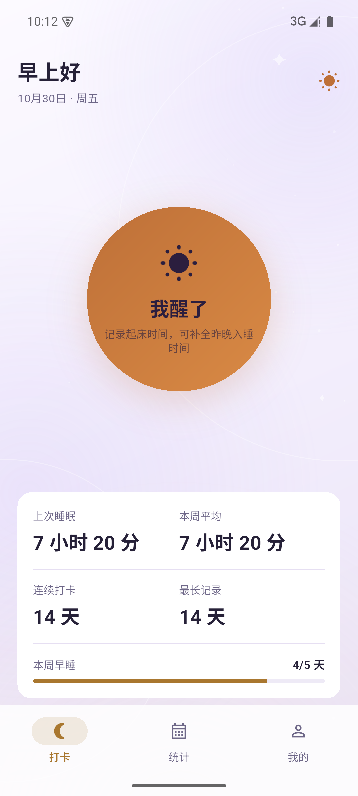 | 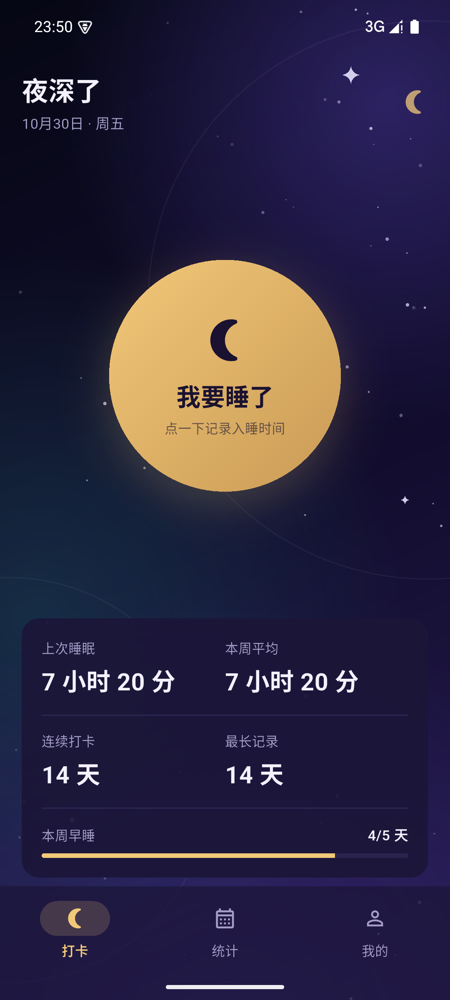 | 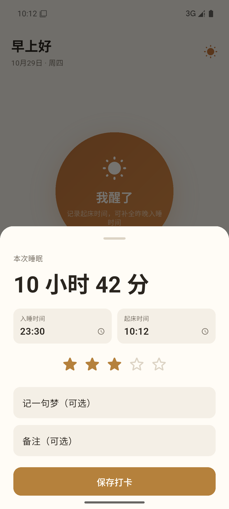 |

| 统计日历 | 月趋势 | 徽章墙 |
|:---:|:---:|:---:|
| 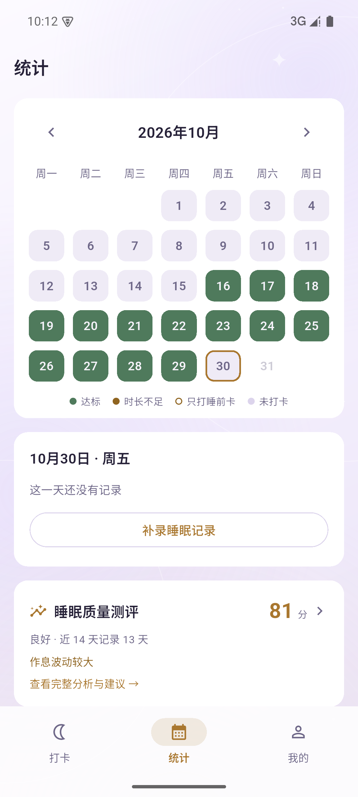 | 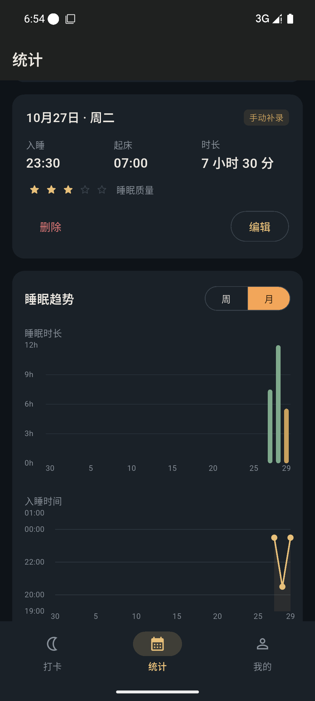 | 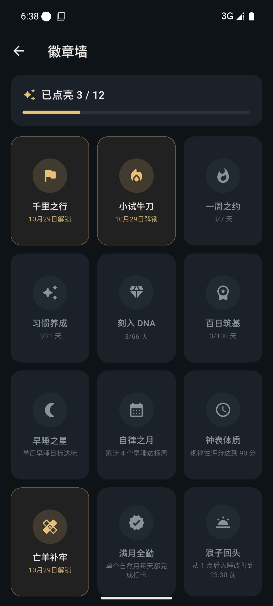 |

| 测评入口 | 测评详情 · 评分 | 测评详情 · 建议 |
|:---:|:---:|:---:|
| 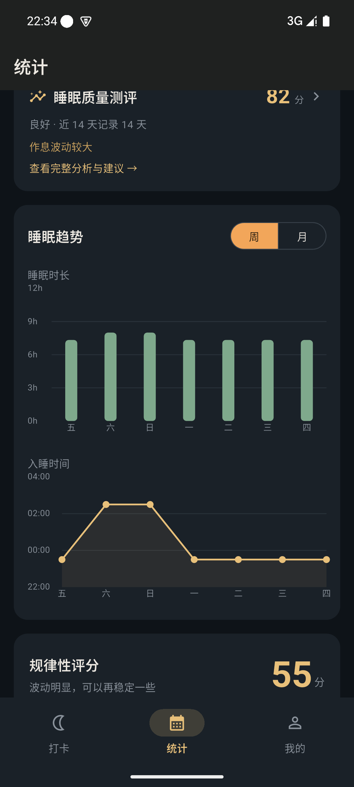 | 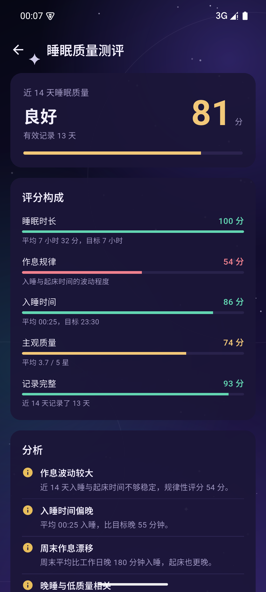 | 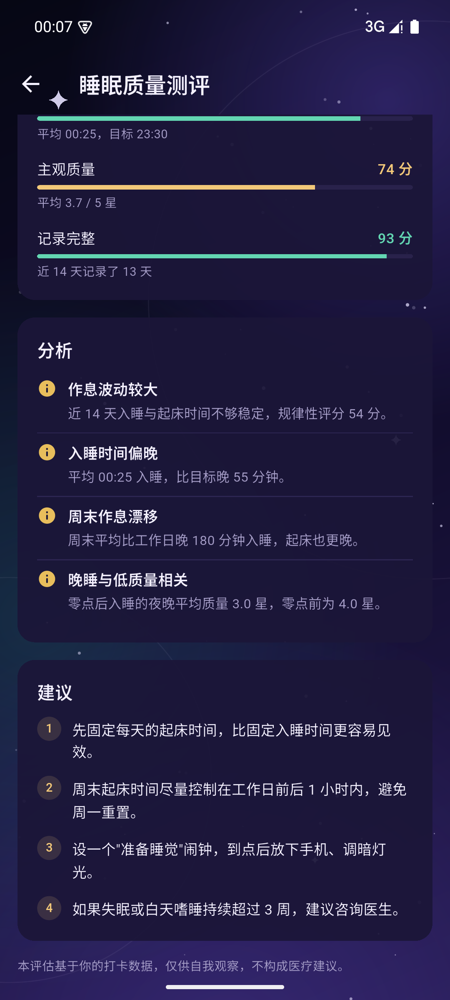 |

| 睡眠余额 | 打卡提醒 | 应用图标 |
|:---:|:---:|:---:|
| 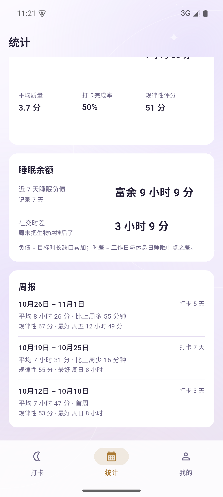 | 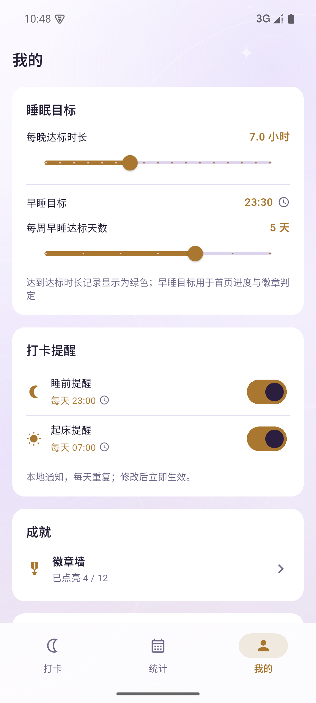 |  |

## 技术栈

| 层 | 选型 |
|----|------|
| UI | Flutter 3.47 / Dart 3.13，Material 3 |
| 状态管理 | Riverpod 3 |
| 数据 | drift 2 + sqlite3（SQLite 本地库） |
| 图表 | fl_chart |
| 日历 | table_calendar |
| 通知 | flutter_local_notifications + flutter_timezone（按系统时区排期） |
| 文件 | file_picker（JSON 备份导入导出） |

```
lib/
├── data/         数据库表结构与 DAO
├── logic/        打卡归属、统计、徽章、睡眠测评等纯函数
├── screens/      首页 / 统计 / 徽章墙 / 设置 / 测评
├── services/     备份、通知
├── theme/        浅色 / 深色调色板与 Material 主题
├── widgets/      星级、趋势图、徽章庆祝动效
└── providers.dart
test/             34 个测试（逻辑 + 三页面冒烟）
docs/             产品计划书与截图
```

## 构建

环境要求：Flutter 3.47+、Dart 3.13+、JDK 17、Android SDK 36。

```bash
flutter pub get
dart run build_runner build --delete-conflicting-outputs
flutter build apk --release
```

产物：`build/app/outputs/flutter-apk/app-release.apk`（通用包，含 arm64-v8a / armeabi-v7a / x86_64）。

说明：

- release 构建目前使用 debug 签名，仅适合自用安装，不可上架应用商店。
- 国内网络可设置 `PUB_HOSTED_URL=https://pub.flutter-io.cn` 与 `FLUTTER_STORAGE_BASE_URL=https://storage.flutter-io.cn`。
- 首次构建时 sqlite3 原生库需从 GitHub Releases 下载；若网络受限，可在 `pubspec.yaml` 的 `hooks.user_defines.sqlite3.url_pattern` 配置代理（包内会校验 SHA-256）。

运行测试：

```bash
flutter analyze
flutter test
```

## 数据与隐私

- 数据库位于应用沙箱内 `app_flutter/sleep_checkin.sqlite`，覆盖安装保留。
- 卸载 App 会连同数据一起删除，卸载前先在「我的 → 导出备份」保存 JSON。
- 备份包含睡眠记录、设置和徽章，换机后导入即可恢复。

## 文档

产品设计、数据模型、排期与视觉规范见 [docs/睡眠打卡APP计划书.md](docs/睡眠打卡APP计划书.md)。

## 版本

当前版本 v0.6.0（versionCode 7），安装包见仓库 Releases。